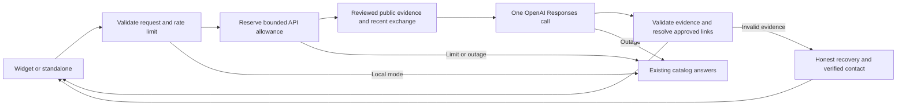

# AI conversation architecture — 10 November 2026

Compass now has one assistant implementation for the website widget and standalone
chat. In AI mode the model handles the conversation **before** the catalog's fixed
handlers. Local mode and the existing forms remain available.



## What this takes from AMS

The public [AMS Berufsinfomat description](https://www.ams.at/arbeitsuchende/aus-und-weiterbildung/berufsinformationen/berufsinformation/berufsinfomat)
documents ChatGPT-generated answers grounded in maintained organisational
knowledge, follow-up conversations, reset and feedback. Compass adopts that
general separation. This is not a copy of AMS's private implementation, nor a
claim of equal or better answer quality. AMS code was not reused.

## Responsibilities

- `app/api/chat/route.ts`: input validation, rate limiting, AI-first routing and
  existing deterministic fallback. An AI failure cannot be labelled AI success.
- `lib/server/assistant.ts`: server-only credentials, one Responses call, 18-second
  timeout, no retries, cooldown on 401/403/429, budget reservation and safe logs.
- `lib/assistant.ts`: the prompt, public evidence projection, output schema and
  validation. The current 46 reviewed records fit a bounded context. This avoids
  a brittle keyword gate deciding whether natural language can reach the model.
  If the request exceeds 80,000 UTF-8 bytes, it falls back rather than silently
  truncating evidence. Growing beyond this should trigger evaluated retrieval,
  not an automatic context/budget increase.
- The current question, up to four recent exchanges and a visitor-supplied name
  are supplied. History is context, not factual evidence. The model can clarify,
  rephrase, acknowledge corrections and help word an inquiry.
- Every fact paragraph must identify a reviewed record and a numbered supporting
  passage supplied by the server. URLs are resolved by the server, never copied from model text. The model does not need to reproduce a source quote;
  paraphrased evidence in an earlier trial caused needless rejection, so the
  final schema selects server-owned passage indices instead.
  Helpful request links are paired with the offer page. Offers with email-only
  contact resolve to their verified page instead of an invented form URL.
- Passage-reference validation does **not** prove semantic entailment. Human review and
  live adversarial cases remain necessary: an unrelated real passage could still
  accompany a wrong claim. No guardrail is advertised as a hallucination guarantee.
- The model has no browsing, mail, booking, write or submission tools. Project and
  feedback delivery remain in their existing confirmed form endpoints. The chat
  cannot produce a valid receipt. Typical fabricated transaction confirmations
  are rejected, but that pattern check is not a universal semantic guarantee.
- `/api/search` uses MiniSearch locally in both modes. Switching on chat AI no
  longer opens an unbudgeted embeddings call. Supabase is not needed for this chat
  path; import/maintenance tooling and existing public-retrieval tests remain.

## Configuration and rollout

Server-only values (never place a key in the embed snippet):

```dotenv
COMPASS_LOCAL_ONLY=false
OPENAI_API_KEY=<private active project key>
OPENAI_CHAT_MODEL=gpt-5.6-luna
COMPASS_AI_DAILY_BUDGET_USD=0.25
COMPASS_QUOTA_DB=/path/to/private/persistent/quota.sqlite
```

`render.yaml` intentionally remains local-only until the hosting environment is
reviewed and a live release is selected. A valid laptop key is not proof that
Render has the same key. The local API trial does not deploy anything.

The existing model is retained. Standard prices checked against
[OpenAI's model page](https://developers.openai.com/api/docs/models/gpt-5.6-luna)
on 10 November 2026 are $0.20/M input and $1.20/M output tokens. The ledger reserves
a conservative estimate before each call: input UTF-8 byte count plus overhead,
and the full 1,800 output-token ceiling, without cache discounts or refunds. It
can therefore stop earlier than the actual invoice would require. Recheck prices
before changing the model; an unpriced model override fails closed. A zero budget
disables calls. Existing HTTP rate limits also apply.

This is a single-host application allowance, **not** an account-wide billing cap.
It survives a process restart only when the database survives. Render free
storage is ephemeral and redeploys can reset it. Separate replicas do not share a
counter. Do not call it a durable monetary guarantee on the current free host.
Use appropriate provider project controls before a public AI rollout; this pass
does not change account billing settings or buy a persistent disk.

Rollback: set `COMPASS_LOCAL_ONLY=true` and restart the service. The same widget,
URL and forms work with local answers. Reverting this release is not necessary
just to turn off inference. For code rollback, revert its release commit and
follow the existing Render rollback instructions in `deployment.md`.

## Privacy

AI mode sends the question, supplied recent context/name and public ForJu records
to OpenAI only. `store:false` disables stored Response objects; it does not mean
zero provider retention. See [OpenAI data controls](https://developers.openai.com/api/docs/guides/your-data).
The source catalog contains approved public summaries, not the internal uploaded
document. No conversation database or new provider was introduced. Existing
per-tab recovery remains, and the expandable visitor notice now describes AI
processing. Project/report data still goes through the existing Resend adapter
only after the visitor sends the form; there were no real mail sends in this pass.
The host's privacy information must cover this processing before public use.

## Repeatable checks

Offline and free:

```sh
npm test
npm run test:release
```

The full release suite uses isolated storage, blocked outbound traffic and local
mail fixtures; it must remain `COMPASS_LOCAL_ONLY=true`. It cannot establish live
AI answer quality.

For a live synthetic trial, build first and start a **separate loopback** server
with the configuration above, an isolated quota database and `RESEND_API_KEY=`:

```sh
npm run build
COMPASS_LOCAL_ONLY=false COMPASS_QUOTA_DB=/tmp/compass-ai-trial.sqlite RESEND_API_KEY= node --env-file=.env.local node_modules/next/dist/bin/next start -H 127.0.0.1 -p 4197
```

In another terminal, run the bounded German/English scenarios (at most eight calls):

```sh
node tools/assistant-checks/live.mjs --live
node tools/assistant-checks/browser.mjs --live
node tools/assistant-checks/live.mjs --live --holdout
```

The holdout check adds four fresh turns. The browser check makes four additional synthetic calls, opens the source pages,
then closes/reopens the widget at desktop and phone viewport sizes. It uses a
clearly labelled, browser-only preview on separate origins; it does not install
anything on forju.at. It requires the existing visitor-check dependencies and
Chrome. Physical phone keyboard behaviour is a separate check.

Live results go to ignored `work/assistant-checks/`. The runner fails if any reply
is a local fallback rather than an actual OpenAI response. It records expected
facts/links but explicitly asks for human review of claim support and usefulness.
The optional `capture.cjs` records synthetic model output/usage only for diagnosis;
never load it on a public service or when a real visitor is testing.

`X-Compass-Answer-Mode` distinguishes `openai`, `local` and `fallback` on chat
responses. `X-Compass-Fallback` provides a bounded reason code without revealing
prompts, credentials or raw provider errors. These are maintainer diagnostics,
not extra labels in the conversation.

No new dependencies were added. Reused OpenAI JS SDK: Apache-2.0; MiniSearch: MIT;
Zod: MIT; existing Playwright and axe tooling remain development-only.
